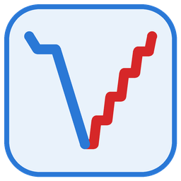

# UVP6 finescale segmentation

Splits each rosette dive of a UVP6 CTD project into clean **downcast** and **upcast** segments, and writes the
UVPapp **sample header** (`uvp6_header_*.txt`) with one profile per segment.

A segment keeps only images taken while the rosette **moves** through water it reaches **for the first time** in
that direction. Images taken while the rosette heaves back, stops (soak, bottle stops) or sits at the bottom are
left out. The aim is to compare particles in undisturbed water (downcast) with particles in water just crossed by
the rosette (upcast), without counting the same particles many times during stops.

## Quick start: the app

The whole processing runs from an app in your web browser, with no code to edit (Windows). The app runs on your
own computer, on your own data, and nothing is sent anywhere.

### Once: install

1. **Download the code**: green **Code** button at the top of this page, then **Download ZIP**, and extract it,
   e.g. to `C:\UVP6\UVP6_finescale_segmentation`.
2. **Python**, either way:
   - **Miniconda** (recommended): install it from [anaconda.com/download](https://www.anaconda.com/download/success)
     with the default options, open **Anaconda Prompt** from the Start menu and type:
     ```
     cd C:\UVP6\UVP6_finescale_segmentation
     conda env create -f environment.yml
     ```
     This creates an environment called `uvp6_finescale`, in a few minutes.
   - or any **Python 3.10+** already on the computer: the app installs its packages
     (`requirements.txt`: streamlit, pandas, matplotlib) the first time it starts.

### Every time: run

Double-click [`start_UVP6_finescale_segmentation.bat`](start_UVP6_finescale_segmentation.bat). A black window
opens, then the app opens in your browser at http://localhost:8501. Keep the black window open while you use the
app; close it to stop the app. (Tip: make a desktop shortcut to the .bat and give it the icon
`assets/UVP6_finescale_segmentation.ico`.)

The page has five steps:

1. **Choose the UVP6 project**: the UVPapp project folder (`uvp6_sn…`, holding `raw/`, `ecodata/`, `meta/`), then
   work from **raw** (recommended) or **ecodata**; each choice shows what the project holds (e.g. "✅ 37 deployments",
   "⚠️ empty"). The title turns green once the project is found, with its number of deployments. One deployment = one rosette dive = one RAW file (`yyyymmdd-HHMMSS`).
2. **Cruise metadata**, the same for every deployment: cruise ID, ship, sample type. The cruise ID is
   proposed from the project's `config/cruise_info.txt` (`acron=`) when it exists; the camera settings
   (image volume, aa, exp, pixel size) are read from the data.
3. **Deployment metadata**, one row per deployment, filled in like a spreadsheet: `ctdref`, `stationid`,
   `latitude`, `longitude`, `bottomdepth`, `comment`, `constantdepth`. It can be pre-filled from an existing UVPapp
   header of the project, or from a CSV, and saved as a CSV. Deck tests (very short RAW files) are unticked.
4. **Run**: the button is enabled once nothing is missing (the list of what is missing is shown in red). It
   segments every deployment, saves the segments and one figure per deployment, then writes the sample header.
5. **Results**: download the sample header, the figures and the segments table; view each deployment's figure.

## Outputs

| File | Where |
|---|---|
| Sample header for UVPapp, one line per segment | `<project>/meta/uvp6_header_<project name without "uvp6_">.txt` |
| Previous sample header, if there was one | `<project>/meta/archives/<same name>.backup_<yyyymmdd_HHMMSS>` |
| All segments (first and last image, time, pressure) | `<project>/casts_segmented/all_segments.csv` (folder can be changed) |
| One figure per deployment | `<project>/casts_segmented/figures/<deployment>_segments.png` |

- **Header name**: UVPapp only reads the header named after the project folder, so the new header takes that name
  and the old one is moved to `meta/archives/` first. The new header is written completely before the old one is
  moved: if anything fails, nothing is replaced.
- **Profile names** are made automatically: `<cruise ID>_<ctdref>_d01`, `_d02`… for downcasts and `_u01`… for
  upcasts, numbered in time order (e.g. `jc282_Rebels2_CTD001_d01`). Nothing is repeated if `ctdref` already
  starts with the cruise ID.
- **Image numbers** follow UVPapp, which counts from 0: the first image line of `<deployment>_data.txt` is image 0.
- **sampledatetime** is the time of the first image of the segment.

## The segmentation method

The pressure of the UVP6 is updated once every 10 images, so the cast is handled as *pressure blocks* (runs of
images with the same pressure). A block is kept when:

- it is strictly deeper (downcast) or shallower (upcast) than every earlier block, counted from the start of the
  file, so a depth already crossed (e.g. by a false start before going back to the surface) is never kept again;
- the next block continues in the same direction;
- it is one block long: a longer run of the same pressure means the rosette was stopped.

The downcast ends at the first block within a band (default 5 dbar) of the maximum pressure, unless the descent is
still unbroken there; the upcast starts once the rosette has risen above that band. Images of the bottom stop
belong to neither. Deployments shallower than the band (deck tests) are skipped.

This is `uvp6_updown_segments_fromraw_firstpassage_nostop.py`: the first-passage method of
`uvp6_updown_segments_fromraw_firstpassage.py` (both read RAW files; `uvp6_updown_segments.py` is the original version
for ecodata), plus the rejection of stopped blocks.

**Working from ecodata**: UVPapp has already cut each cast into profiles and the images between them are not
there, so the method runs inside each profile and never sees a whole cast. Use it only when there is no RAW.

## Files

| File | Role |
|---|---|
| `UVP6_finescale_segmentation_app.py` | the app (Streamlit) |
| `start_UVP6_finescale_segmentation.bat` | starts the app (Windows) |
| `UVP6_finescale_segmentation_tool.py` | functions used by the app: listing, segmentation, figures, header; also a simpler desktop window (`python UVP6_finescale_segmentation_tool.py`) |
| `uvp6_updown_segments_fromraw_firstpassage_nostop.py` | the segmentation method, also usable alone: `python uvp6_updown_segments_fromraw_firstpassage_nostop.py <project>/raw -o <output> --plot` |
| `uvp6_updown_segments_fromraw_firstpassage.py` | the first-passage method without the stopped-block rule (reference) |
| `uvp6_updown_segments.py` | original method on ecodata; its readers are used for ecodata projects |
| `requirements.txt`, `environment.yml` | Python packages |
| `assets/` | icon |
